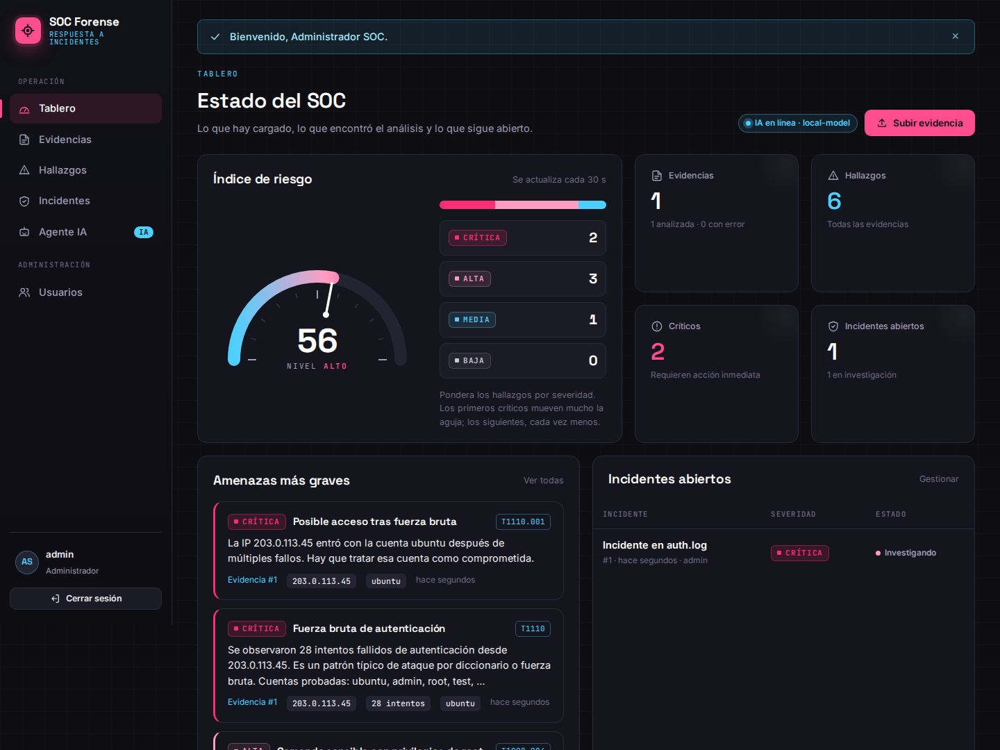
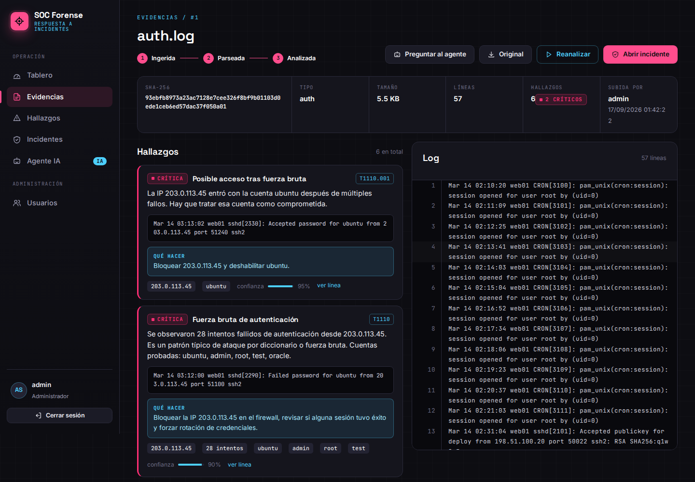
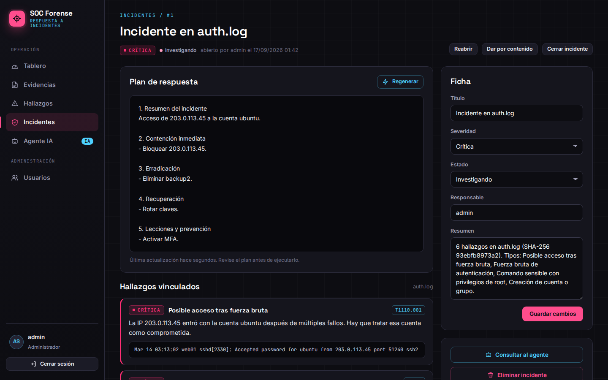

# SOC Forense

Aplicación web para analizar logs de seguridad y responder a incidentes. Usted sube un `auth.log`, un `audit.log` o los accesos de un servidor web. El sistema sella el archivo con SHA-256, estructura cada línea y detecta ataques con reglas propias y con un modelo de IA local. Después ayuda a abrir el incidente y a redactar el plan de respuesta.

Está hecha en Java (Servlets y JSP) y se ejecuta con tres programas: **NetBeans**, **Tomcat 11** y **MySQL** (administrado desde MySQL Workbench). La IA es opcional. Sin ella la aplicación sigue detectando amenazas con su motor de reglas.



| Ficha de evidencia | Incidente con plan de respuesta |
|---|---|
|  |  |

---

## 1. Qué necesita instalado

| Programa | Para qué |
|---|---|
| JDK 17 o superior | Compilar y ejecutar. Tomcat 11 no arranca con versiones anteriores. |
| Apache NetBeans (versión reciente) | Abrir el proyecto, compilarlo y desplegarlo. |
| Apache Tomcat 11 | Servidor donde corre la aplicación. Descárguelo como `.zip` y descomprímalo en una carpeta. |
| MySQL Server 8 y MySQL Workbench | Base de datos. |
| LM Studio (opcional) | Modelo de IA local para el agente. |

La primera vez que abra el proyecto, NetBeans necesita internet para descargar las librerías (driver de MySQL, JSTL y otras). Después funciona sin conexión. Las fuentes tipográficas vienen dentro del proyecto.

---

## 2. Puesta en marcha

### Paso 1. MySQL

1. Abra MySQL Workbench y verifique que el servidor esté iniciado (menú **Server → Startup/Shutdown**).
2. Compruebe con qué usuario y contraseña se conecta. El proyecto viene configurado con `root` / `root`.
3. Si su contraseña es otra, edite `src/main/resources/application.properties` y cambie `db.password`.

No hace falta crear la base de datos. Al arrancar, la aplicación crea el esquema `soc_forense`, sus tablas y las cuentas iniciales. Si prefiere crearla a mano, tiene el script en `sql/soc_forense.sql`.

### Paso 2. Abrir el proyecto en NetBeans

1. **File → Open Project** y elija la carpeta `soc-forense` (NetBeans la reconoce como proyecto Maven por el ícono).
2. Espere a que termine la descarga de dependencias (barra inferior derecha).

### Paso 3. Registrar Tomcat 11 (solo la primera vez)

1. **Tools → Servers → Add Server… → Apache Tomcat or TomEE**.
2. En *Server Location* elija la carpeta donde descomprimió Tomcat 11.
3. Escriba un usuario y una contraseña para el administrador de Tomcat y marque **Create user if it does not exist**.
4. **Finish**.

### Paso 4. Ejecutar

1. Clic derecho sobre el proyecto → **Properties → Run**.
2. En *Server* elija el Tomcat 11 que registró. *Context Path* debe decir `/soc-forense`.
3. Clic derecho sobre el proyecto → **Run** (o F6).

El navegador abre `http://localhost:8080/soc-forense`.

---

## 3. Cuentas iniciales

| Usuario | Contraseña | Rol |
|---|---|---|
| `admin` | `Admin1234` | Administrador |
| `analista` | `Analista1234` | Analista |

Cambie ambas contraseñas desde **Mi cuenta** (clic en su nombre, abajo a la izquierda). Las contraseñas iniciales se pueden cambiar antes del primer arranque en `application.properties` (`seed.admin.password` y `seed.analyst.password`).

### Qué puede hacer cada rol

| Acción | Administrador | Analista | Observador |
|---|:---:|:---:|:---:|
| Ver tablero, evidencias, hallazgos e incidentes | ✔ | ✔ | ✔ |
| Conversar con el agente IA | ✔ | ✔ | ✔ |
| Subir, parsear y analizar logs | ✔ | ✔ | |
| Abrir y editar incidentes, pedir planes de respuesta | ✔ | ✔ | |
| Eliminar evidencias e incidentes | ✔ | | |
| Crear, editar, desactivar y eliminar usuarios | ✔ | | |

Los cambios de rol y las desactivaciones rigen desde el siguiente clic del usuario afectado, sin esperar a que cierre sesión. El sistema no permite quedarse sin un administrador activo.

---

## 4. Prueba rápida con los logs de muestra

La carpeta `muestras/` trae dos archivos preparados:

- **`auth.log`**: un ataque SSH completo. Hay 28 intentos fallidos desde `203.0.113.45`, luego un ingreso exitoso con la cuenta `ubuntu`, la creación de la cuenta `backup2` y una clave SSH agregada para no perder el acceso. Además, un segundo atacante menor.
- **`access.log`**: un escáner que prueba 20 rutas sensibles (`/.env`, `/.git/config`, `/phpmyadmin/`…) y una inyección SQL con `sqlmap`.

Entre como `admin`, vaya a **Evidencias**, arrastre `auth.log` al recuadro y deje marcada la casilla *Parsear y analizar al subir*. Sin IA debería ver 6 hallazgos, 2 de ellos críticos. En la ficha de la evidencia, las líneas sospechosas aparecen marcadas en rosado dentro del visor del log. Desde ahí puede **Abrir incidente** y, en el incidente, **Generar plan**.

---

## 5. Agente de IA con LM Studio

1. Instale [LM Studio](https://lmstudio.ai) y descargue un modelo *instruct*. Con 16 GB de RAM funcionan bien modelos de 7 u 8 mil millones de parámetros, por ejemplo Qwen2.5 7B Instruct o Llama 3.1 8B Instruct.
2. Cargue el modelo y, en la pestaña **Developer**, pulse **Start Server**. Debe quedar escuchando en el puerto `1234`.
3. En el tablero de SOC Forense, el indicador superior cambia a **IA en línea**.

No hace falta configurar el nombre del modelo: LM Studio usa el que tenga cargado. Los modelos que "piensan en voz alta" (Qwen3, DeepSeek-R1) también sirven, porque la aplicación descarta ese razonamiento interno y se queda con la respuesta.

Si usa otro servidor compatible con la API de OpenAI (Ollama, vLLM), cambie `ai.base.url` y ponga el nombre exacto del modelo en `ai.model`.

### Qué hace la IA

- **Análisis de evidencias.** Lee el log por bloques de 60 líneas y devuelve hallazgos en JSON con severidad, técnica MITRE ATT&CK, indicadores y recomendación.
- **Agente conversacional.** Antes de cada respuesta recibe el estado real de la plataforma (conteos, amenazas graves, incidentes abiertos). Si usted elige una evidencia, también recibe sus hallazgos y las primeras líneas del log. Recuerda los últimos 12 mensajes de su conversación.
- **Planes de respuesta.** Redacta contención, erradicación, recuperación y lecciones aprendidas a partir de los hallazgos vinculados al incidente.

### Por qué IA y reglas juntas

Un modelo que lee por bloques no ve patrones repartidos en todo el archivo, como 28 intentos fallidos desde una misma IP. Las reglas sí los ven, pero no entienden lo que no está previsto. Por eso el análisis siempre hace las dos cosas:

1. Las reglas recorren el archivo completo.
2. La IA lee las líneas y aporta su propia lectura.
3. Si ambas marcan la misma línea, se fusionan: queda la severidad más alta, la técnica más precisa y la unión de indicadores. Lo que solo detecta la IA se agrega.

El mensaje al terminar dice qué pasó, por ejemplo: *"La IA confirmó 2 hallazgos de las reglas y agregó 1."*

En logs de más de 480 líneas, al modelo solo se envían las líneas con señales de ataque (fallos, sudo, errores HTTP, firmas de inyección). Las reglas siguen revisando todo. El límite se ajusta con `ai.max.lines`.

### Si la IA no está disponible

Nada se detiene. El análisis usa solo las reglas, el plan de respuesta sale de una plantilla con los hallazgos reales y el chat responde con datos de la base (conteos, amenazas graves, IPs vistas). Cada pantalla avisa cuando ocurre.

---

## 6. Detecciones del motor de reglas

| Detección | Técnica MITRE | Severidad |
|---|---|---|
| Fuerza bruta de autenticación (5 o más fallos por IP) | T1110 | media, alta desde 10, crítica desde 20 |
| Ingreso exitoso desde una IP que venía fallando | T1110 | crítica |
| Comando como root que toca cuentas, claves SSH o permisos | T1136.001 / T1098.004 | alta |
| Otro uso de sudo como root | T1548.003 | media |
| Creación de cuenta o grupo local | T1136.001 | alta |
| Firma de ataque web (inyección SQL, `../`, XSS, sqlmap, nikto) | T1190 | alta |
| Barrido de rutas web (15 o más respuestas 404 por IP) | T1595 | media |

Formatos que el parser reconoce: syslog clásico y con fecha ISO (`auth.log`, `secure`, `sudo`), `auditd` y accesos de Apache y Nginx. Las líneas que no encajan se guardan igual, sin perder evidencia, y la IA las lee como texto.

---

## 7. Configuración

Todo está en `src/main/resources/application.properties`. Cada valor se puede sobreescribir con una variable de entorno: mayúsculas y guiones bajos en lugar de puntos (`db.password` → `DB_PASSWORD`).

| Clave | Valor por defecto | Uso |
|---|---|---|
| `db.url`, `db.user`, `db.password` | MySQL local, `root` / `root` | Conexión a la base |
| `evidence.dir` | `<carpeta de usuario>/soc-forense/evidencias` | Dónde se guardan los logs subidos |
| `upload.max.mb` | `25` | Tamaño máximo por archivo |
| `ai.enabled` | `true` | `false` para no intentar conectar con la IA |
| `ai.base.url` | `http://localhost:1234/v1` | Servidor de IA |
| `ai.model` | `local-model` | Nombre del modelo |
| `ai.timeout.seconds` | `90` | Espera máxima por respuesta |
| `ai.max.lines` | `480` | Líneas máximas que se envían al modelo por evidencia |
| `ai.<perfil>.temperature`, `top.p`, `top.k`, `max.tokens`, `frequency.penalty`, `presence.penalty` | ver sección 12 | Parámetros de inferencia por tarea (analisis, chat, plan) |
| `ai.context.window`, `ai.context.margin` | `8192`, `256` | Ventana de contexto del modelo y margen de seguridad |
| `ai.rag.lines` | `40` | Líneas relevantes que recibe el agente sobre una evidencia |
| `ai.max.concurrent`, `ai.queue.wait.seconds` | `2`, `30` | Consultas simultáneas al modelo y espera máxima en cola |
| `ai.cost.input.per.million`, `ai.cost.output.per.million` | `0` | Tarifa en USD para estimar el costo (TCO) |

Las evidencias se guardan fuera de la carpeta temporal a propósito: el sistema operativo puede vaciarla, y perder un archivo rompe la cadena de custodia.

---

## 8. Seguridad incluida

- Contraseñas con BCrypt, nunca en texto plano.
- Token CSRF en todo formulario y en cada llamada del chat.
- Bloqueo de 2 minutos tras 5 intentos fallidos de ingreso (por usuario e IP).
- Identificador de sesión nuevo al iniciar sesión, cookie `HttpOnly` y `SameSite=Lax`, sesión de 45 minutos.
- Todo texto que viene de un log o de un usuario se escapa al mostrarlo. Un log con `<script>` no ejecuta nada.
- El usuario se vuelve a leer de la base en cada petición, para aplicar al instante roles y desactivaciones.
- Descarga del archivo original con su SHA-256 en la cabecera `X-Evidence-SHA256`.

---

## 9. Problemas frecuentes

**Aparece una página que dice "No hay conexión con la base de datos".** MySQL está apagado o la contraseña no coincide. La página muestra el error exacto y se recarga sola; cuando MySQL responda, la aplicación entra sin reiniciar Tomcat.

**NetBeans marca errores en las dependencias o dice que no encuentra `com.mysql.cj.jdbc.Driver`.** Faltó internet al abrir el proyecto. Conéctese y use clic derecho → **Build with Dependencies**.

**El puerto 8080 está ocupado.** Cambie el puerto en `conf/server.xml` de Tomcat, o en NetBeans desde **Tools → Servers**.

**El tablero dice "IA sin respuesta".** LM Studio no está abierto, no tiene modelo cargado o el servidor local no está iniciado. Revise la pestaña Developer.

**El análisis con IA tarda mucho.** Es normal con modelos grandes en equipos sin GPU. Use un modelo más pequeño, suba `ai.timeout.seconds` o baje `ai.max.lines`. Si una respuesta supera el tiempo máximo, la aplicación no repite la petición y sigue con las reglas.

**Después de redesplegar me pide iniciar sesión otra vez.** Es lo esperado: las sesiones no se guardan entre reinicios.

---

## 10. Estructura del proyecto

```
soc-forense/
├── pom.xml                     Dependencias Maven
├── nb-configuration.xml        Preferencias de NetBeans (despliegue en Tomcat)
├── docs/capturas/              Capturas de la interfaz
├── muestras/                   Logs de ejemplo para probar
├── sql/soc_forense.sql         Esquema para MySQL Workbench (opcional)
└── src/main/
    ├── java/com/soc/forense/
    │   ├── ai/                 Cliente de IA y prompts del analista
    │   ├── config/             Configuración y conexión a MySQL (HikariCP)
    │   ├── dao/                Acceso a datos (JDBC)
    │   ├── filter/             Sesión, roles y CSRF
    │   ├── listener/           Arranque y apagado
    │   ├── model/              Usuario, evidencia, línea, hallazgo, incidente, mensaje
    │   ├── service/            Parser, análisis, incidentes, agente, usuarios
    │   ├── util/               Utilidades web y formato
    │   └── web/                Servlets
    ├── resources/              application.properties y schema.sql
    └── webapp/
        ├── assets/             CSS, JavaScript y fuentes
        └── WEB-INF/views/      Páginas JSP
```

---

## 11. Respecto al proyecto original

El proyecto original estaba en Python con FastAPI y SQLite. Se reescribió en Java para ejecutarse solo con NetBeans, Tomcat 11 y MySQL, y conserva su lógica: SHA-256 por evidencia, estados *ingerida → parseada → analizada*, severidades baja/media/alta/crítica y cliente para LM Studio. Lo nuevo es el CRUD de usuarios con tres roles, los incidentes con plan de respuesta, el agente conversacional, el análisis combinado de IA y reglas, y la interfaz en negro, rosado, blanco y celeste.

---

## 12. Parámetros generales de la plataforma de IA

La pantalla **Parámetros IA** (menú lateral) muestra, en solo lectura, cómo está configurado el modelo y cómo opera la plataforma. Todo se ajusta en `application.properties` sin recompilar.

### 12.1 Parámetros de inferencia (comportamiento del modelo)

Cada tarea tiene su propio perfil, porque no se le pide lo mismo al modelo cuando devuelve JSON que cuando conversa. Clave: `ai.<perfil>.<parámetro>`.

| Parámetro | Qué controla | Análisis | Chat | Plan |
|---|---|:---:|:---:|:---:|
| Temperatura (`temperature`) | Aleatoriedad: baja = determinista, alta = creativa | 0.1 | 0.3 | 0.4 |
| Top-p (`top.p`) | Muestreo de núcleo: palabras hasta esa probabilidad acumulada | 0.9 | 0.9 | 0.95 |
| Top-k (`top.k`) | Solo las k palabras más probables (0 = no se envía) | 40 | 40 | 50 |
| Máximo de tokens (`max.tokens`) | Longitud máxima de la respuesta | 3000 | 1024 | 1500 |
| Penalización por frecuencia | Evita repetir las mismas palabras | 0 | 0.3 | 0.2 |
| Penalización por presencia | Evita volver a los mismos temas | 0 | 0.2 | 0.1 |

El análisis usa penalizaciones en 0 porque el JSON repite claves a propósito y castigarlas rompe el formato. `top_k` no existe en la API oficial de OpenAI: si usa ese proveedor, póngalo en 0.

**Ventana de contexto (`ai.context.window`, 8192 por defecto).** Antes de cada llamada se estima el tamaño (~4 caracteres por token). Si no cabe, se descartan los mensajes más antiguos del historial, luego se recorta el contexto más largo y por último se reduce el máximo de tokens. El valor debe coincidir con el *Context Length* del modelo en LM Studio.

### 12.2 Criterios operativos de la plataforma

- **Gestión y calidad de datos (RAG).** Los logs se sellan con SHA-256, se estructuran línea por línea y se guardan en MySQL. Cuando el analista elige una evidencia, el agente recibe las `ai.rag.lines` líneas más relevantes para su pregunta (se puntúan por IPs, usuarios y términos, con equivalencias como *fuerza bruta → failed*), además de los hallazgos y el estado real de la plataforma.
- **Rendimiento y precisión.** Por tarea se miden llamadas, tasa de éxito, latencia media, p95 y máxima, tokens de entrada y salida, respuestas cortadas por `max_tokens` y ajustes de contexto. La precisión se mide con la **concordancia IA–reglas**: cuántos hallazgos de las reglas confirmó la IA frente a cuántos agregó. Las métricas viven en memoria desde el último arranque.
- **Escalabilidad y recursos.** `ai.max.concurrent` limita las consultas simultáneas al modelo para no saturar RAM o GPU; las que esperan más de `ai.queue.wait.seconds` se atienden con el motor de reglas. El costo (TCO) se estima con `ai.cost.input.per.million` y `ai.cost.output.per.million` (0 con un modelo local). No hay bloqueo de proveedor: la API es la estándar compatible con OpenAI, así que cambiar a Ollama, vLLM o la nube es cambiar `ai.base.url` y `ai.model`.
